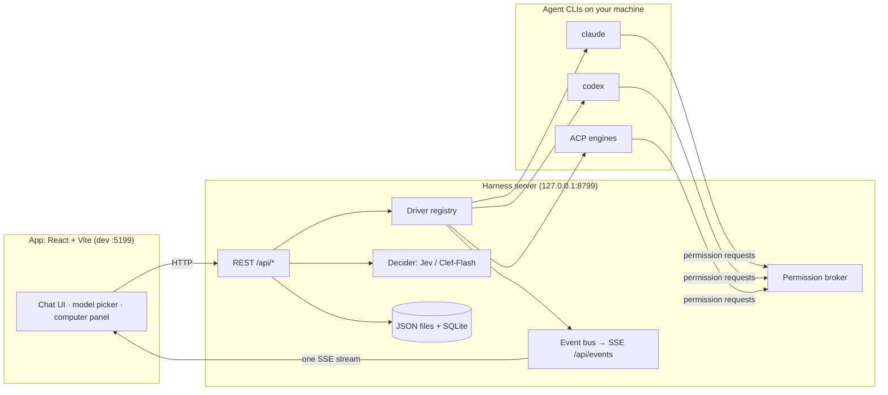

<div align="center">


# ASTER

**A local-first chat app where every contact is a real AI agent.**

Each bot runs on an agent CLI already installed on your machine (Claude Code, Codex, or any
ACP-speaking engine) and has its own personality, model, computer, and connected apps.
Talk to bots like contacts, watch them work, and approve what matters.


</div>

> ASTER is a fork of [OpenMausBot](https://github.com/milind-soni/OpenMausBot) by Milind Soni and its
> contributors. Most of the engine, server, and app come from upstream; ASTER adds its own brand and UI
> layer, decision-model routing for rooms, and a companion sidecar. See [Provenance](#provenance).

---

## Contents

- [Why ASTER](#why-aster)
- [Capabilities](#capabilities)
- [Architecture](#architecture)
- [Tech stack](#tech-stack)
- [Repository layout](#repository-layout)
- [Getting started](#getting-started)
- [Configuration](#configuration)
- [Development](#development)
- [Testing and builds](#testing-and-builds)
- [Deployment](#deployment)
- [Security and privacy](#security-and-privacy)
- [Roadmap](#roadmap)
- [Provenance](#provenance)
- [License](#license)

## Why ASTER

A single assistant in a single box is the wrong shape for agents. ASTER treats AI as a **messaging
app**: a roster of bots you chat with, each with its own thread memory, model, computer, and tools.

- **Bring your own agents.** Bots run on CLIs you already have (`claude`, `codex`, `gemini`, `grok`,
  and others), using your existing logins and subscriptions. No new account and no proxy in the middle.
- **Local first.** One harness server on `127.0.0.1` owns every agent process. Bots, transcripts,
  settings, and keys stay on your machine.
- **You stay in control.** Risky actions turn into approval cards. Secrets are write-only.

## Capabilities

Each item below has an implementation in this repository; paths point to where it lives.

| Capability | What it does | Where |
|---|---|---|
| **Multi-engine bots** | Built-in drivers for Claude, Codex, OpenCode, Qwen, Gemini, Grok, Kimi, Droid, Cursor, Hermes, Pi, Antigravity, MiniMax and a cloud-computer agent, plus any ACP CLI or OpenAI-compatible endpoint through config. An unknown driver shows as "unavailable" and does not crash the others. | `server/drivers/`, [`docs/custom-engines.md`](docs/custom-engines.md) |
| **Per-bot model picker** | Choose a model per bot, and switch it mid-conversation. | `server/model-catalog/`, `src/components/` |
| **Rooms with Auto routing** | In a room set to Auto, a fast decision model (TypeSafe Jev, or Cloudflare Workers AI Clef-Flash) picks which bot answers a message that @-mentions no one. If it is off, unsure or slow (1.5 s timeout), the room's lead answers instead. | `server/decider/`, [`docs/decision-model.md`](docs/decision-model.md) |
| **Approvals** | Shell commands, file edits, and questions appear as inline Allow / Deny cards from a permission broker. | `server/permission-proxy.ts`, [`docs/approval-levels.md`](docs/approval-levels.md) |
| **Computers** | Each bot can use a cloud desktop (Boat), an isolated local VM (Docker/Podman), or, after you opt in, this computer through the Cua driver. | `server/boat.ts`, `electron/`, [`docs/computer-use-integration.md`](docs/computer-use-integration.md) |
| **Connected apps** | Gmail, Slack, GitHub, Notion and more through Composio, plus your own MCP servers. | [`docs/composio.md`](docs/composio.md), [`docs/custom-mcp-servers.md`](docs/custom-mcp-servers.md) |
| **Memory** | Each bot has a workspace with `MEMORY.md` and topic files, and every memory change can be undone. | `server/memory-*.ts`, [`docs/memory.md`](docs/memory.md) |
| **Routines and webhooks** | Scheduled runs (once, on chosen weekdays, or every 5–1,440 minutes) and webhook triggers on a separate loopback receiver. | `server/routines.ts`, [`docs/routine-schedules.md`](docs/routine-schedules.md) |
| **Team sharing** | Export or import a whole team (bots, rooms, routines, instructions) as one file. Chat history and secrets are never included. | [`docs/team-sharing.md`](docs/team-sharing.md), [`docs/presets.md`](docs/presets.md) |
| **Voice** | Read replies aloud through ElevenLabs, Fish Audio, Grok (xAI), built-in macOS voices, or a local Chatterbox server. Calls work on macOS. | `server/tts/`, [`docs/voice-mode.md`](docs/voice-mode.md) |
| **MCP server** | A stdio MCP server lets external clients inspect and drive bots, rooms, and tasks. It does not expose approvals, deletion, or credentials. | `scripts/mcp-server.ts`, [`docs/mcp-server.md`](docs/mcp-server.md) |
| **Desktop and mobile** | Electron builds for macOS, Windows, and Ubuntu 24.04; iOS and Android companion apps pair with a running server. | `electron/`, `ios/`, `android/`, [`docs/ios-companion.md`](docs/ios-companion.md) |
| **Localization** | The UI ships in English, German, Spanish, French, Hindi, Japanese, Brazilian Portuguese, Ukrainian, and Simplified and Traditional Chinese. | `src/locales/`, [`docs/localization.md`](docs/localization.md) |

## Architecture

There are two processes. The app has no agent transports of its own: it sends typed HTTP commands and
reads a single replayable SSE stream. The harness server owns every agent process and converts each
provider's protocol into one canonical event stream.



| Layer | Where | Role |
|---|---|---|
| Renderer | `src/` | React chat shell with a server-backed store and one reducer. |
| Wire contract | `shared/wire.ts` | Types shared by the server and every client. |
| Server | `server/index.ts`, `server/routes/` | Plain `node:http` server with REST and SSE. New routes go in `server/routes/*` modules. |
| Drivers | `server/drivers/`, `server/contracts.ts` | One driver per engine behind a small SPI. |
| Persistence | `server/store.ts`, `server/message-db.ts` | Atomic JSON (`bots.json`, `groups.json`, `config.json`) plus `node:sqlite` transcripts. No external database. |
| Desktop | `electron/` | `main.mjs` forks the bundled server with `utilityProcess.fork`; `preload.cjs` exposes `window.ogb`. |
| Companion | `companion/` | Sidecar for paired phones (mDNS). It is the only component that listens off-machine. |
| Edge services | `cloudflare/` | The Composio broker and control-plane Workers. |

The deep reference is [`docs/architecture.md`](docs/architecture.md); there is a study-guide version in
[`docs/aster-capabilities.md`](docs/aster-capabilities.md).

## Tech stack

- **Language:** TypeScript (strict). The server runs directly with `node --experimental-strip-types`;
  `tsc` only typechecks until packaging.
- **UI:** React 19, Vite 7, Tailwind CSS 4, Radix Slot, Mermaid, KaTeX, Shiki.
- **Server:** Node ≥ 24 (`node:http`, `node:sqlite`), zod, ajv, croner, undici.
- **Desktop:** Electron, electron-builder, electron-updater.
- **Tooling:** pnpm 10, oxlint, vitest, wrangler.
- **Mobile:** Swift (iOS) and Kotlin (Android).
- **Docs site:** `apps/docs` (Next.js).

## Repository layout

```text
src/            React renderer (components/, state/, lib/, locales/, styles.css)
  components/aster/   ASTER-brand UI (context panel, mark, mascot)
server/         Harness server (drivers/, decider/, routes/, harness/, tts/, testing/)
shared/         Wire contract and logic shared by server and clients
electron/       Desktop shell: main process, preload bridge, updater, computer use
companion/      Phone-pairing sidecar
cloudflare/     Composio broker and control-plane Workers
ios/, android/  Native companion apps
apps/docs/      Documentation website
docs/           Engineering docs, verification recipes, plans and specs
evals/          Behavior evaluations for bots
scripts/        Build, packaging, smoke-test and verification tooling
deploy/         Docker Compose, Podman, Fly.io and local deployment recipes
build/          Desktop icons, entitlements and Linux packaging hooks
public/         Static web assets (app icon, wallpapers)
third_party/    Vendored code with its license and provenance records
enterprise/     Source-available enterprise layer (separate license)
skills/         Bundled agent skills
```

## Getting started

### Prerequisites

- macOS, Windows, or Ubuntu 24.04 x64
- **Node.js 24 or newer** and **pnpm 10** (`corepack enable` gives the pinned version)
- At least one agent CLI, installed and signed in:
  [`claude`](https://claude.com/claude-code), [`codex`](https://github.com/openai/codex), or another
  supported engine. Installed engines appear in the model picker automatically.
- To package for macOS: Xcode command-line tools (Swift)

### Install and run from source

```sh
git clone https://github.com/asteragent1011-cyber/ASTER.git
cd ASTER
pnpm install --frozen-lockfile

pnpm dev:server    # harness server → http://127.0.0.1:8799
pnpm dev           # web UI        → http://127.0.0.1:5199
pnpm dev:desktop   # Electron shell; keep the two commands above running
```

To run the server through the CLI entry point instead (setup, serve, pair):

```sh
pnpm aster setup   # interactive first-run setup
pnpm aster serve   # serve and print a pairing link
pnpm pair          # mint a pairing code for another device
```

## Configuration

Local chat needs no configuration. Integrations are turned on by pasting keys in **App Settings**,
where they are stored locally and never shown again. You can also set environment variables.

Every `ASTER_*` variable falls back to its older `OMB_*` name, so existing setups keep working.

| Variable | Purpose | Default |
|---|---|---|
| `ASTER_PORT` / `OMB_PORT` | Harness server port | `8799` |
| `ASTER_WEBHOOK_PORT` / `OMB_WEBHOOK_PORT` | Webhook-only receiver port | server port + 1 |
| `ASTER_DATA_DIR` / `OMB_DATA_DIR` | Data directory (bots, transcripts, config) | `~/.openmausbot` |
| `ASTER_UI_PORT` / `OMB_UI_PORT` | Vite dev server port | `5199` |
| `DECIDER_PROVIDER` / `OMB_DECIDER_PROVIDER` | Decision model for Auto rooms: `jev`, `clef-flash`, or `off` | `jev` |
| `OMB_JEV_API_KEY` | TypeSafe Jev key (also settable in the UI) | — |
| `CLOUDFLARE_ACCOUNT_ID`, `CLOUDFLARE_API_TOKEN` | Clef-Flash credentials | — |

The Compose deployment reads its own variables (`OMB_HTTP_PORT`, `OMB_PUBLIC_URL`, `ENGINES`, …);
[`.env.example`](.env.example) and [`deploy/.env.example`](deploy/.env.example) document them.

Optional third-party credentials:

| Credential | Enables | Guide |
|---|---|---|
| Composio project key (`ak_…`) | Connected apps | [`docs/composio.md`](docs/composio.md) |
| Boat API key | Cloud Linux desktop per bot (paid after trial) | [docs.boat.dev](https://docs.boat.dev/api-keys) |
| ElevenLabs / Fish Audio / xAI key | Hosted voices | [`docs/voice-mode.md`](docs/voice-mode.md) |

## Development

```sh
pnpm typecheck        # app + server (tsc)
pnpm lint             # oxlint, warnings are errors
pnpm i18n:check       # locale packs match the English source
pnpm check:electron   # syntax-check Electron entry points
pnpm docs:dev         # documentation site
pnpm mcp              # stdio MCP server
pnpm eval             # behavior evals
```

Changes to the server or conversation flow must be verified against an **isolated fixture**, never
against your real data. See [`AGENTS.md`](AGENTS.md) and [`docs/verification/README.md`](docs/verification/README.md):

```sh
node --experimental-strip-types scripts/control-aster.ts launch
pnpm control:aster doctor --url http://127.0.0.1:PORT
```

## Testing and builds

```sh
pnpm exec vitest run <files>   # targeted tests
pnpm test                      # vitest + broker + Electron node tests + packaged-server smoke
pnpm build                     # typecheck + production UI build → dist/
pnpm build:server              # bundled server → dist-server/
pnpm docs:build                # documentation site
```

Desktop packages (output in `release/`):

```sh
pnpm package:mac      # DMG + ZIP (needs Swift/Xcode tools)
pnpm package:win      # NSIS installer + ZIP
pnpm package:linux    # Ubuntu x64 .deb + AppImage
```

CI is defined in [`.github/workflows/`](.github/workflows/). The `CI` gate job in `ci.yml` is the
merge verdict; [`docs/ci.md`](docs/ci.md) explains how jobs are selected. Releases are covered in
[`docs/releasing.md`](docs/releasing.md).

## Deployment

| Target | Guide |
|---|---|
| Local Docker Compose | [`deploy/local/README.md`](deploy/local/README.md) |
| Rootless Podman (Linux, Windows/WSL2) | [`deploy/podman/README.md`](deploy/podman/README.md) |
| VPS / always-on host | [`docs/deploy-vps.md`](docs/deploy-vps.md), [`docs/self-hosting.md`](docs/self-hosting.md) |
| Ubuntu desktop | [`docs/linux-desktop.md`](docs/linux-desktop.md) |
| Bring your own VPS for bot computers | [`docs/byo-vps.md`](docs/byo-vps.md) |

Remote devices pair once with a short code. To expose ASTER beyond loopback, use Tailscale or your
own HTTPS reverse proxy; never publish the server port directly.

## Security and privacy

- The harness server binds to **127.0.0.1**. Mutating requests need the desktop's per-launch
  capability or a paired session.
- **Secrets are write-only.** Keys go in through `PUT /api/config` or desktop credential storage, and
  the API only ever returns `configured` flags.
- Every risky agent action goes through the **permission broker** unless you have explicitly set that
  bot to Full access.
- Agent processes are never spawned through a shell with user-influenced strings.
- Control of your own computer is opt-in, and stays disabled on Ubuntu Wayland.
- Shared team files never carry chat history, credentials, permissions, or computer access.
- When the CLI is used in API-key mode, keys are saved in plain text in `config.json` (mode `0600` on
  Unix). Protect that data directory.

Please report vulnerabilities privately; [`SECURITY.md`](SECURITY.md) explains how.

## Roadmap

These items are planned and not yet built:

- Publish the first ASTER release and container image, then point the Compose defaults at
  `ghcr.io/asteragent1011-cyber/aster` instead of the upstream image.
- Re-check and resolve the known gaps listed in [`docs/architecture.md` §8](docs/architecture.md),
  such as decider configuration precedence and the `.well-known` path mismatch.
- Refresh the documentation screenshots for the ASTER interface.
- Add native dictation on Ubuntu, and make bot control of this computer safe on Wayland.

Longer-term design notes are in [`docs/plans/`](docs/plans/) and [`docs/superpowers/`](docs/superpowers/).

## Provenance

ASTER is an independent fork of [OpenMausBot](https://github.com/milind-soni/OpenMausBot). It is not
affiliated with or endorsed by the OpenMausBot maintainer, xAI, or any cryptocurrency or token. Some
internal identifiers keep the upstream name on purpose, because changing them would break existing
installs, updates, or paired devices:

- app ID `com.openmausbot.app` and URL scheme `openmausbot://`
- the data directory `~/.openmausbot`
- the `OMB_*` environment variables (aliased by `ASTER_*`)
- the preload bridge `window.ogb`
- the well-known path `/.well-known/openmausbot/*`
- the npm package name `openmausbot`, the Linux executable `openmausbot`, and the `omb` /
  `control:omb` scripts
- the phone-credential HPKE context string, shared with the upstream mobile apps

## License

[Apache License 2.0](LICENSE). Copyright © 2026 ASTER contributors; derived from OpenMausBot,
copyright © 2026 Milind Soni and OpenMausBot contributors. Attribution notices are in [NOTICE](NOTICE).

The exception is `enterprise/`, which is source-available under its [own license](enterprise/LICENSE).
Deleting that folder leaves the open-source edition. See [LICENSING.md](LICENSING.md) for details.

Vendored third-party components keep their own licenses; see [`third_party/`](third_party/).
"OpenMausBot", "Grok" and other names are trademarks of their respective owners.
